<div align="center">
  
  <br />
  <a href="https://creative-portfolio-sable.vercel.app">
    
  </a>
  <a href="https://github.com/ninouse/creative-portfolio">
    
  </a>
  <br /><br />
  
  
  
  
  
</div>


## ✨ 一个不只是“作品列表”的作品集

**Creative Portfolio** 把个人介绍、技能、项目经历和视觉叙事放进同一个数字空间。它不追求信息堆叠，而是用节奏、层次和动效，让访问者自然地完成从“认识你”到“记住你”的过程。

> 不是静态简历，而是一段有节奏的个人表达。

## 🎞️ 视觉与动效

- **宇宙感视觉语言** 🌌
  深色背景、柔和光晕、轨道线和粒子细节，形成克制但有记忆点的视觉氛围。

- **Motion-first 交互** 🎬
  基于 Framer Motion 的页面过渡、卡片悬浮、内容进入和微交互，让浏览过程更有节奏。

- **内容驱动动画** 🧭
  动效服务于信息层级和阅读路径，而不是为了动画而动画。

- **响应式体验** 📱
  桌面端和移动端使用同一套视觉语言，保持布局、间距和交互的一致性。

## 🌍 国际化与体验

- 中英文自动检测，并支持手动切换语言
- 路由懒加载，减少首屏负担
- 语义化结构、键盘可访问性和减少动态效果偏好支持
- 基于设计令牌统一颜色、字体、圆角和间距


## 🧰 技术星座

<div align="center">
  
</div>

| Layer | Tools |
| --- | --- |
| Frontend | React 19, Vite 7, React Router 7, Tailwind CSS 3 |
| Motion & UI | Framer Motion, Lucide Icons, custom design tokens |
| Internationalization | i18next, automatic language detection |
| Backend | Express for local development, Vercel Serverless in production |

## 🚀 快速开始

需要 Node.js LTS。

```bash
git clone https://github.com/ninouse/creative-portfolio.git
cd creative-portfolio
```

启动后端：

```bash
cd backend
npm install
node index.js
```

启动前端：

```bash
cd frontend
npm install
npm run dev
```

- Frontend: `http://localhost:5174`
- Backend: `http://localhost:3001`

<details>
  <summary><strong>展开项目结构</strong></summary>

```text
creative-portfolio/
├── frontend/
│   └── src/
│       ├── components/      # Reusable interface pieces
│       ├── pages/           # Route-level experiences
│       ├── hooks/           # Data and interaction hooks
│       ├── services/        # API access
│       ├── models/          # Data shaping
│       ├── locales/         # English and Chinese copy
│       ├── constants/       # Shared configuration
│       └── styles/          # Global styles and motion tokens
├── backend/                 # Local Express service
├── api/                     # Vercel serverless functions
└── vercel.json              # Deployment configuration
```

</details>

## 🌐 部署

```bash
npm i -g vercel
vercel --prod
```

## 📄 License

MIT

<div align="center">
  <br />
  <strong>Made with curiosity, motion, and code. ✦</strong>
</div>
